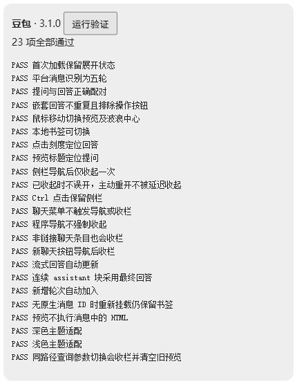

<div align="center">


# AI Thread Navigator

### 长对话，自有章法。

**把滚动的距离，变成回访的刻度。**

为 ChatGPT、Claude 与豆包打造的轻量对话导航脚本。  
让重要的提问与回答，在漫长的聊天中依然触手可及。

[](https://github.com/yyygdhg/ai-thread-navigator/releases/tag/v3.1.0)
[](LICENSE)
[](https://raw.githubusercontent.com/yyygdhg/ai-thread-navigator/main/chatgpt-thread-navigator.user.js)
[](https://github.com/yyygdhg/ai-thread-navigator/actions/workflows/check.yml)

**[安装脚本](https://raw.githubusercontent.com/yyygdhg/ai-thread-navigator/main/chatgpt-thread-navigator.user.js)** ·
**[功能一览](#-从滚动到导航)** ·
**[使用方式](#-三步开启)** ·
**[反馈问题](https://github.com/yyygdhg/ai-thread-navigator/issues)**

由 **[Liminal · @yyygdhg](https://github.com/yyygdhg)** 创作与维护

</div>

---

## ✦ 从滚动，到导航

一个问题，接着另一个问题。思路逐渐清晰，对话也越来越长。

当你想回到那段关键解释、那份实现方案，或那个还没完全理解的回答时，不必再凭印象反复拖动滚动条。AI Thread Navigator 将每轮对话变成左侧的一道刻度：**扫过即可预览，点击即可回访，重要的内容可以留下书签。**

| 能力 | 为你带来的体验 |
| --- | --- |
| **波浪刻度** | 鼠标靠近时，最近的刻度伸展，相邻刻度逐渐回落；沿着对话轻轻扫过。 |
| **双向预览** | 同时看到这一轮的提问与回答摘要，找回上下文。 |
| **精准回访** | 点击刻度定位回答，点击预览标题定位提问；两种入口，按需返回。 |
| **本地书签** | 为重要的一轮留下标记，让值得重读的内容更容易找到。 |
| **智能收栏** | 从历史记录切换聊天后自动收起侧栏，为正文腾出空间；首次打开保留原有状态。 |
| **随对话更新** | 新消息和流式回答更新时，刻度与摘要同步跟进。 |
| **顺手的键盘操作** | 支持方向键、Home、End、Enter 与 Escape，也尊重系统减少动画设置。 |

> 封面是交互示意图。实际界面会随网站布局、主题和窗口宽度变化。

## ◈ 一个脚本，三个平台

| 平台 | 支持地址 | 适配重点 |
| --- | --- | --- |
| **ChatGPT** | `chatgpt.com` · `chat.openai.com` | 新旧消息结构、反向滚动容器、原生侧栏状态。 |
| **Claude** | `claude.ai` | 提问与嵌套回答配对、最终回答定位、侧栏切换控件。 |
| **豆包** | `www.doubao.com` · `doubao.com` | 原生收栏按钮、非链接聊天条目、查询参数切换对话。 |

三个平台使用同一套导航体验，各自通过适配器识别页面结构。

## ↗ 三步开启

1. 在浏览器中安装 [Tampermonkey](https://www.tampermonkey.net/)。
2. 打开 **[脚本安装入口](https://raw.githubusercontent.com/yyygdhg/ai-thread-navigator/main/chatgpt-thread-navigator.user.js)**，在脚本管理器的安装页面确认安装。
3. 刷新支持的网站，打开一段已有对话，将鼠标移向页面左侧中央。

如果链接显示的是代码，进入油猴管理面板 → 新建脚本 → 用完整代码替换模板 → **Ctrl + S** 保存。

**从旧版升级：** 编辑原来的 `ChatGPT Sidebar Auto-Collapse on Navigation` 或 `ChatGPT Sidebar Auto-Collapse + Turn Navigator`，替换完整代码并保存，随后刷新页面。只保留一个启用的版本。脚本沿用原有名称和命名空间，以便升级已有安装。

如果脚本管理器未注入脚本，请检查脚本是否启用、是否允许在对应网站运行，并按照管理器针对你当前浏览器给出的扩展权限指引处理。

## ⌘ 让操作跟随你的思路

| 操作 | 结果 |
| --- | --- |
| 悬停刻度 | 波浪展开，并显示当前轮数、提问和回答摘要。 |
| 点击刻度 / 按 Enter | 默认定位到这一轮的回答。 |
| Shift + 点击刻度 | 定位到提问。 |
| 点击预览标题 | 定位到提问。 |
| 点击预览中的回答 | 定位到回答。 |
| 点击书签图标 | 收藏或取消收藏这一轮。 |
| ↑ / ↓ · Home / End | 在刻度之间移动。 |
| Escape | 关闭预览卡片。 |
| 在刻度区域滚动 | 浏览较长对话中更多的轮次。 |

窗口宽度小于 **600 px** 时，刻度默认隐藏，以免遮住正文；自动收栏仍然可用。

<details>
<summary><strong>⚙ 按你的习惯调整</strong></summary>

编辑脚本顶部的 `CONFIG`，保存后刷新页面：

```js
autoCollapse: true,       // 历史记录导航后自动收栏
timeline: true,           // 显示对话刻度
jumpTo: 'assistant',      // 改为 'user'，默认跳到提问
smoothScroll: true,       // 滚动动画
bookmarks: true,          // 本地书签
minViewportWidth: 600,    // 刻度显示所需的最小窗口宽度
```

</details>

## ◇ 轻装运行，内容留在本地

**无需 API Key，没有运行时第三方依赖，脚本不发起网络请求。**

- 从当前网页已渲染的消息中构建导航，不查询隐藏对话分支或历史接口。
- 预览摘要保留在当前聊天的页面内存中，切换聊天后清空。
- 书签仅保存在浏览器的 `localStorage` 中；保存消息标识或短摘要哈希，不保存消息原文。
- 各网站的存储由浏览器按域名隔离，不跨平台同步。
- 没有遥测、分析上报或对话上传逻辑。

脚本管理器可能根据更新地址检查新版本；这属于管理器自身的安装与更新机制。

## ✓ 做过验证，也说明边界

**v3.1.0 已通过 66 项本地浏览器结构与交互回归验证。**

| 本地测试组 | 通过项数 |
| --- | ---: |
| ChatGPT：现代与旧版结构 | 22 |
| Claude：平台适配器 | 21 |
| 豆包：平台适配器 | 23 |
| **合计** | **66** |

这些测试覆盖消息配对、波浪交互、定位、书签、流式更新、主题、侧栏误触防护，以及导航与容器变化。新平台测试使用交付源码的副本，仅替换 hostname 来选择适配器。GitHub Actions 另外执行语法检查，**不将本地的 66 项记录冒充为 CI 浏览器测试**。

实际页面检查包括 ChatGPT 消息及滚动结构，以及豆包公开页面的原生收起与展开按钮。**Claude 与豆包登录后的完整消息流尚未完成真实站点验收**；Claude 的现场访问停在登录安全验证页。这些支持需要安装后在自己的会话中试用。

<details>
<summary><strong>查看验证记录与已知限制</strong></summary>

[完整本地验证记录](docs/verification-3.1.0.txt)



- 自动收栏面向 SPA 导航；整页重新加载仍由网站恢复自身布局。
- 未渲染或已被虚拟化移除的消息可能没有预览。Claude / 豆包完全移除旧节点时，刻度只能涵盖当前挂载的轮次。
- 定位到尚未渲染的消息外壳后，如正文未出现，可能需要轻滚一下让网站加载。
- 没有原生消息 ID 的平台使用摘要哈希与重复次数生成书签标识；编辑提问、调整相同提问的顺序或哈希碰撞可能影响书签。
- 网站改版可能影响选择器；欢迎附上平台、浏览器版本和不含隐私的复现步骤提交 Issue。

</details>

<details>
<summary><strong>运行本地结构与交互验证</strong></summary>

需要已安装 Node.js。无需下载测试依赖：

```bash
node --check chatgpt-thread-navigator.user.js
node tests/prepare-fixtures.cjs
node tests/serve.cjs
```

然后分别打开以下测试页面，点击“运行验证”：

- ChatGPT：`http://127.0.0.1:8787/tests/verify-chatgpt.html`
- Claude：`http://127.0.0.1:8787/tests/verify-multisite.html?site=claude`
- 豆包：`http://127.0.0.1:8787/tests/verify-multisite.html?site=doubao`

用 **Ctrl + C** 停止本地服务。测试页面只包含示例消息，不需要登录 AI 网站。测试通过不能替代真实站点兼容性验收。

</details>

## ✧ 关于这个作品

**作者 / 维护者：[Liminal（@yyygdhg）](https://github.com/yyygdhg)**  
**许可：[MIT](LICENSE)** · Copyright © 2026 Liminal

这个作品把自动收栏与对话导航放在一个脚本里，围绕“更舒服地阅读和回访长对话”持续打磨。刻度与预览的交互灵感来自用户提供的 Codex 界面截图；平台适配逻辑独立实现，不将同类导航概念宣称为首创。

参考与致谢：[ChatGPT Conversation Timeline](https://github.com/zzy665/chatgpt-conversation-timeline)、[Conversation Overview](https://github.com/boabab/conversation-overview)、[AiMsgExport](https://greasyfork.org/en/scripts/568176-aimsgexport/code)、[Claude Voyager](https://github.com/TanChuping/Claude-voyager)。参考了公开的交互说明与 DOM 选择器资料，没有复制其源代码。

---

<div align="center">

**让对话继续向前，也让重要的内容随时可以回去。**

Made by **[Liminal](https://github.com/yyygdhg)** · Built for thoughtful conversations.

</div>
